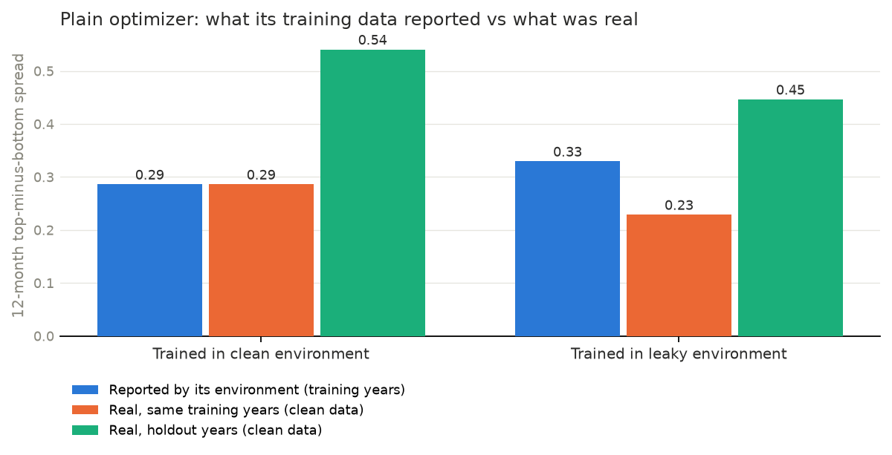

# When the classroom leaks: reinforcement fine-tuning on Fireworks, with a stock-scoring formula as the worked example

*A hands-on guide with code. Everything here runs on Fireworks' managed RFT and Eval Protocol, on free SEC filings and public prices.*
{{DATA_WARNING}}
## TL;DR

- **The setup.** A model proposes a stock-scoring formula; a backtest grades it. The reward is verifiable, cheap to compute and, like most real environments, very easy to leak.
- **The experiment.** The same optimizer and the same RFT recipe, trained once in a point-in-time ("clean") environment and once in an environment with four common shortcuts ("leaky"). Both are graded on the same clean holdout years.
- **The result.** A plain optimizer trained in the leaky environment was told its formula earned a spread of **{{opt_leaky_practice}}** over the training years; on honest data the same formula earned **{{opt_leaky_real_train}}** over those same years. On the clean holdout it delivered **{{opt_leaky_holdout}}**, against **{{opt_clean_holdout}}** for the formula trained clean. The RFT runs are in [section 6](#6-the-leak-experiment).
- **The lesson.** If your reward is verifiable, audit the environment before you tune the algorithm. The cheapest leak test is to train on the leak on purpose and see how far practice and exam drift apart.

---

## 1. Why this problem

Post-training has three ingredients: the question bank (data), the teacher (SFT, DPO or RL) and the classroom (the environment and harness the model practises in). This guide is about the classroom, because that is where a project can look brilliant and still fail in production.

A stock-scoring formula is a good place to study it:

- **The reward is verifiable.** Score stocks with a formula, wait 12 months, check whether high scorers beat low scorers among their peers. No judge model, no labels.
- **It is cheap.** One evaluation is a few milliseconds of numpy, so thousands of RL rollouts cost nothing to grade.
- **It leaks in realistic ways.** Financial data is full of values that look historical but were not known at the time. The original 2021 version of this project ([Finagic](#appendix-the-original-finagic)) made a version of this mistake in its own backtest.

The model's task is narrow on purpose: read the 21 Finagic metrics and propose signed weights, for example `{"roe": 2, "ps": -1, "de": -1}`. The prompt contains no tickers, names or dates, so the model cannot lean on what it remembers about how a company's stock later did.

## 2. The classroom: a point-in-time environment, and four ways to break it

**Data** (all free, so anyone can rerun this):

- **Fundamentals:** annual 10-K facts from SEC EDGAR's XBRL API. Every fact carries the date it was filed, which is what makes point-in-time possible.
- **Prices:** monthly prices from Yahoo Finance.
- **Universe:** the {{n_stocks}} current S&P 500 members outside Financials and Real Estate, whose balance-sheet ratios work differently.

**Each month, for each stock,** the pipeline takes the latest 10-K usable on that date, computes the 21 metrics, converts each to 0-10 points against the stock's 10 nearest peers by market cap in its sector, and records the next 12 months' total return.

**The four leaks.** The leaky environment is the same pipeline with four shortcuts switched on. Each is a mistake people make in real backtests:

| Leak | Clean environment | Leaky environment |
|---|---|---|
| **L1 timing** | A 10-K is usable from the day it was filed | From the last day of the fiscal year, weeks before anyone saw it |
| **L2 restatements** | Values as first reported | Values as later restated |
| **L3 price** | Valuation ratios use the price on the decision date | They use the price at the *end* of the 12-month return window, a narrow version of the 2021 Finagic backtest's mistake (it scored stocks with data from after the start of the returns it measured) |
| **L4 universe** | A stock is investable only after it joined the index | Today's members are investable in every past month, including companies that joined because they grew |

**Not fixed in either environment:** companies that *left* the S&P 500 are missing from both, because the free constituent list only covers current members. Both environments share this survivorship bias, so it does not affect the clean-versus-leaky comparison, but it does flatter absolute numbers.

**Time splits** (by decision month): train 2011-2018, validation 2019-2020, embargo 2021, holdout 2022-01 to 2025-09. Nothing is ever selected on the holdout.

## 3. The exam: designing the reward

For a formula and a 12-month window of decision months:

1. **Spread.** Each month, within each sector, take the average 12-month return of the top third of stocks by score minus the bottom third, then average across sectors and months.
2. **Relative to a baseline.** `reward = 0.5 + 0.5 * tanh((spread - spread_v1) / 0.04)`, so 0.5 means "as good as the fixed v1 formula on the same window". Comparing within the window removes market-wide swings that would otherwise swamp the signal.
3. **Format.** An answer with no parsable JSON, unknown metric keys, or fewer than three non-zero weights scores 0.
4. **Concentration penalty.** If one metric carries more than 40% of the total absolute weight, the reward is reduced. Single-metric bets are the cheapest way to look good on one window by luck.

Each training row is one 12-month window. Every row has the same prompt; only the grading window differs. That keeps the experiment clean: the clean and leaky RFT jobs see identical prompts and differ only in what the reward is computed from.

Following Fireworks' evaluator guidance, test the evaluator on hand-written good and bad answers before training; `checks/test_core.py` does this, including a check that a formula preferring expensive stocks scores higher in the leaky environment than in the clean one.

## 4. Cheap rungs first

Before any RL, see how far cheap methods get on the same reward. On clean data unless noted:

{{METHOD_TABLE}}

*Spreads are average 12-month return differences between the top and bottom thirds within each sector, in percentage points. "Spread it saw in practice" is the training-period spread in the environment the method learned in; for v0 and v1 it is the leaky environment's training-period number, i.e. what a leaky backtest would have reported.*

- **v0 vs v1.** The original formula, quirks included, against the bug-fixed one: {{v0_holdout}} vs {{v1_holdout}} on the holdout.
- **The plain optimizer** is coordinate search over the 21 signed weights. It takes seconds and sets the bar any RL run has to clear.
- **Best-of-N** samples a base model on Fireworks N times, picks the formula with the best *training* spread, and reports its holdout spread.

Inference cost and latency for the sampling runs:

{{INFERENCE_TABLE}}

## 5. RFT on Fireworks, step by step

The evaluator is an [Eval Protocol](https://github.com/eval-protocol/python-sdk) test in `evaluator/test_finagic_rft.py`. It parses the answer, backtests it on the row's window, and returns the reward with the spread and a "beats v1" flag as extra metrics, so they show up per rollout in the dashboard.

```bash
# 1. datasets: same prompts, different grading environments; holdout is always clean
python scripts/04_make_rft_data.py --no-think          # --no-think for Qwen3 base models
python scripts/05_upload_datasets.py

# 2. check the evaluator locally on a few rows (calls FINAGIC_EVAL_MODEL)
pytest evaluator/test_finagic_rft.py -vs

# 3. clean run: dataset comes from the test's input_dataset (rft/train_clean.jsonl)
ep create rft --yes \
  --base-model accounts/fireworks/models/qwen3-8b \
  --output-model finagic-clean \
  --evaluation-dataset accounts/$FIREWORKS_ACCOUNT_ID/datasets/finagic-holdout-clean-v1 \
  --epochs 3 --response-candidates-count 8 --temperature 0.9 --max-output-tokens 1536

# 4. leaky run: identical except the training dataset
ep create rft --yes \
  --dataset finagic-train-leaky-v1 \
  --base-model accounts/fireworks/models/qwen3-8b \
  --output-model finagic-leaky \
  --evaluation-dataset accounts/$FIREWORKS_ACCOUNT_ID/datasets/finagic-holdout-clean-v1 \
  --epochs 3 --response-candidates-count 8 --temperature 0.9 --max-output-tokens 1536
```

Three things worth knowing:

- **One evaluator, two environments.** The evaluator reads the environment from each row, so both jobs share it, and the evaluation dataset grades both on the same clean exam.
- **The data ships with the evaluator.** Eval Protocol uploads the project folder as the evaluator's code, so the compact panel in `evaluator/data/panel.npz` travels with it. Raw downloads live in `data/`, which `.gitignore` excludes from the upload.
- **Cost.** At the time of writing, Fireworks lists RFT as free for models under 16B parameters. The only spend in this guide is the inference for best-of-N.

What to watch in the dashboard: the training reward curve and the evaluation reward on the held-out dataset. If training reward climbs while held-out reward stays flat or falls, the model is learning the classroom, not the subject.

## 6. The leak experiment

**Plain optimizer.** Trained in the leaky environment, its formula's training-years spread was reported as {{opt_leaky_practice}}; on clean data over the same years it was {{opt_leaky_real_train}}, and on the clean holdout {{opt_leaky_holdout}}. The formula trained clean: {{opt_clean_practice}} on the training years, {{opt_clean_holdout}} on the holdout. Compare bars within a period, not across periods: market conditions differ between the training and holdout years.



**Fireworks RFT.** Same prompts, same recipe, same clean exam:

{{RFT_TABLE}}

{{RFT_CHART}}

**Which leak does the damage?** The optimizer again, with one leak switched on at a time:

{{ABLATION_TABLE}}

**What to read into it:**

- **The gap between what the environment reported and what was real is the leak, measured.** Same formula, same years, two environments. It is the most useful single number this setup produces, and it is cheap: the optimizer version takes minutes.
- **The direction matters as much as the size.** L3 rewards formulas that like *expensive* stocks, because a price taken from the end of the return window is high exactly when the stock went up. In this run, the formula learned in the leaky environment treated these price multiples as "higher is better": **{{leaky_val_up}}**; the one learned clean: **{{clean_val_up}}**. One leak at a time, the most damaging on the clean holdout was **{{worst_leak}}**.
- **RL does not fix a leaky environment; it exploits it faster.** That is the job description of an optimizer.

## 7. What I would tell a customer

1. **Write the environment's "as-of" rules before the reward.** For each input, say when it became knowable. Most leaks are a missing date.
2. **Run the leak on purpose.** Train once in an environment you have deliberately broken. If practice and exam don't diverge, your leak detector is blind; if they diverge a lot, you know which shortcuts matter.
3. **Climb the cost ladder.** A deterministic optimizer, then best-of-N with a base model, then RFT. Each rung is the baseline for the next, and the cheaper one sometimes wins.
4. **Make the evaluation dataset the honest one.** Fireworks RFT takes a separate evaluation dataset; point it at clean, held-out data even when you train elsewhere.
5. **Put diagnostics in the reward's metrics.** Returning the spread and a "beats baseline" flag per rollout made the dashboard readable without extra tooling.

## 8. Friction log

*Notes from building this, for the Fireworks team. The first three were hit while writing the code; the rest are to be filled in from the RFT runs.*

- **Install fails on Python 3.13.** `pip install eval-protocol` pulls `hydra-core`, whose pinned `antlr4-python3-runtime` failed to build a wheel on Python 3.13 in my environment; I had to install a newer runtime by hand. A supported-Python note in the quickstart, or a relaxed pin, would save new users a detour.
- **A flag the error message names doesn't exist.** In eval-protocol 0.3.32, `ep create rft` says "Provide --dataset or --dataset-jsonl", but there is no `--dataset-jsonl` flag. Running a second job on a different local JSONL means uploading it as a dataset first (`scripts/05_upload_datasets.py`).
- **Docs and CLI disagree on the rollout count flag.** The CLI reference shows `--n 8`; the 0.3.32 CLI exposes `--response-candidates-count` (generated from the SDK signature) and has no `--n`.
- *(from the runs)*
- *(from the runs)*

## 9. Limitations

- **Survivorship.** Former index members are missing (see section 2). Absolute spreads are flattered; the clean-versus-leaky comparison is not affected because both environments share the gap.
- **Classification.** Sectors are today's GICS sectors, applied to the past.
- **Annual data only.** The 2021 Finagic used quarterly data; this version uses 10-K annual facts to keep the as-of logic simple. Quarterly 10-Q data would add three updates a year.
- **Noise.** Monthly decisions with 12-month returns overlap, so months are not independent observations. Treat differences of a point or two as noise.
- **Not investment advice.** This is a testbed for environment design, not a trading strategy, and nothing here claims to beat the market.

## 10. Reproduce it

See [README.md](README.md). Steps 1-3 need no Fireworks account; the optimizer leak experiment runs on a laptop in minutes.

## References

- Fireworks: [Reinforcement fine-tuning](https://docs.fireworks.ai/fine-tuning/reinforcement-fine-tuning-models), [Evaluators](https://docs.fireworks.ai/fine-tuning/evaluators), [Monitoring RFT training](https://docs.fireworks.ai/fine-tuning/monitor-training), [Eval Protocol CLI](https://docs.fireworks.ai/fine-tuning/cli-reference), [Text-to-SQL quickstart](https://github.com/eval-protocol/text-to-sql-quickstart) (the structural template for this repo)
- Nathan Lambert, [RLHF Book](https://rlhfbook.com/), especially the chapters on over-optimization and evaluation
- Leakage in LLM finance work: [Profit Mirage](https://arxiv.org/abs/2510.07920v1), [TEMPO](https://arxiv.org/pdf/2605.18843), ["What survives honest evaluation?"](https://arxiv.org/pdf/2608.27734)
- Data: [SEC EDGAR APIs](https://www.sec.gov/search-filings/edgar-application-programming-interfaces), [S&P 500 constituents (datasets/s-and-p-500-companies)](https://github.com/datasets/s-and-p-500-companies)

## Appendix: the original Finagic

Finagic (2021) scored ~5,000 US stocks 0-10 against their peers across five equally weighted categories: valuation, performance, profitability, capital management and risk. Each of the 21 metrics was min-max scaled against the company's peers and its sector average; categories and the final score were rounded to integers. The v0 formula here reproduces it, including two directions that were never inverted (EV/EBITDA and cash conversion cycle) and missing values treated as zero. Its 2021 backtest scored stocks with the data available on the day it ran and measured returns over an earlier period, so the scores contained information from after the returns began. Leak L3 above isolates the price part of that mistake.
