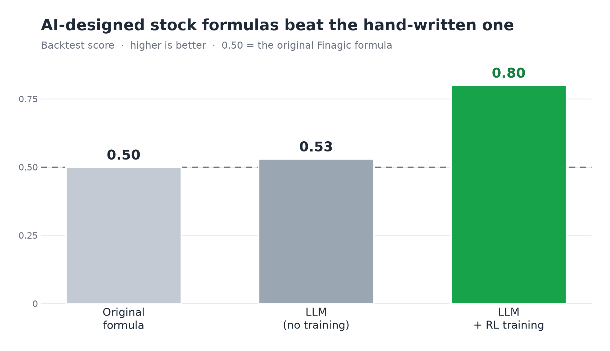

# Finagic RL 🧪📈

Teaching an LLM to design stock‑screening formulas with reinforcement learning —
using an old fundamental‑analysis system as a **verifiable‑reward** playground.

> **TL;DR** I dusted off *Finagic*, a fundamental‑analysis stock screener I built
> years ago, and used reinforcement fine‑tuning (on Fireworks' serverless
> Training API) to see if an LLM could learn a better scoring formula than my
> hand‑written one. On the backtest, it did — and the whole experiment cost about **$1**.



## The idea

Finagic scores S&P 500 companies from their 10‑K filings using a **formula of
signed weights** over fundamental metrics (reward strong fundamentals, penalize
red flags), then backtests that formula as a long/short return spread.

That makes it a great RL training ground: **the reward is verifiable.** A
formula's reward is computed by actually backtesting it on 15+ years of real
market data — no human labels, no LLM judge. (Same reason math and code are
great RL tasks.)

So: let an LLM propose formulas, reward it by how well they backtest, and train
it with GRPO.

## The result (backtest)

Score scale: **0.50 = the original hand‑written formula.** Higher is better.

| Formula source | Backtest score |
|---|---|
| Original hand‑written formula | 0.50 |
| LLM, zero‑shot (no training) | 0.53 |
| **LLM + RL training** | **0.80** |

The RL‑trained model's formulas clearly beat the one I hand‑tuned years ago — on the backtest.

> **Caveats (please read).** RL is noisy and real conclusions need many seeds; I
> only ran a couple. These are **backtest** numbers and do **not** predict future
> performance. At best this is a rudimentary screener — not an edge, and not
> something to trade on. The real goal here was to experiment with RL.
> **Not financial advice.**

## How it works

Reinforcement fine‑tuning on
[Fireworks' serverless Training API](https://docs.fireworks.ai/fine-tuning/training-api/serverless)
(tinker‑compatible SDK), GRPO‑style:

1. The LLM proposes a scoring formula (JSON weights).
2. We **backtest it locally** with `finagic.core.reward_for` → a reward in [0, 1]
   (0.5 = as good as the original formula on that window).
3. GRPO updates the model on‑policy — Fireworks runs the GPUs, you own the reward function.
4. LoRA on a 30B base model, fully serverless, ~$1 total.

The reward adapter and the training loop live in
[`scripts/rft_serverless.py`](scripts/rft_serverless.py).

## Quickstart

```bash
# 1. setup
make setup
source .venv/bin/activate
make check                      # runs the core tests

# 2. keys (type your own; never commit them)
export SEC_USER_AGENT="Your Name you@email.com"   # SEC EDGAR requires a contact
export FIREWORKS_API_KEY=fw_...
export FIREWORKS_ACCOUNT_ID=your-account-id

# 3. build data + baselines (the original formula's scores)
python scripts/01_fetch_data.py   # SEC filings + prices (~15-20 min)
python scripts/02_build_panel.py
python scripts/03_baselines.py

# 4. RL fine-tune
uv pip install "fireworks-ai[training]" tinker
git clone https://github.com/fw-ai/cookbook ~/fw-cookbook
export FINAGIC_COOKBOOK=~/fw-cookbook
python scripts/rft_serverless.py --smoke          # local reward check — no spend
python scripts/rft_serverless.py --check-wiring   # no spend
python scripts/rft_serverless.py --train clean --i-will-pay   # billable (~$1)
```

Full write‑up (setup, numbers, honest caveats):
[`results/RFT_SERVERLESS_RESULTS.md`](results/RFT_SERVERLESS_RESULTS.md).

## Repo layout

| Path | What's in it |
|---|---|
| `finagic/` | the screener — metrics, scoring, backtest, and the reward function |
| `scripts/` | data fetch, panel build, baselines, and the RL training (`rft_serverless.py`) |
| `evaluator/` | the reward/grading logic written as a test |
| `results/` | the write‑up and the backtest chart |

## Cost

The entire experiment — sampling + RL training — cost about **$1** on Fireworks serverless.

---

Built with [Fireworks AI](https://fireworks.ai). Not financial advice.
