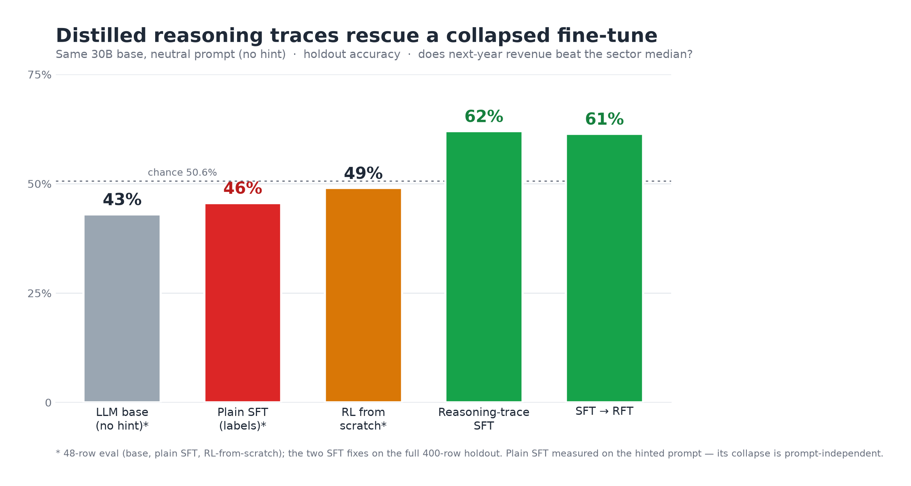

# Can an LLM predict which company out-grows its sector? A $1 RL experiment

**One-line finding:** every technique that works lands at the same **~62% ceiling** — a
dumb momentum rule, a carefully-prompted model, a fine-tuned 30B, and Claude Opus cold.
The extra fundamentals add nothing. The interesting results are *why* each method lands
where it does — and what RL actually buys you.

## The task

Take an old fundamental-analysis screener (Finagic) and turn it into a **pointwise,
verifiable prediction**: given one company's latest 10-K fundamentals next to its
sector-peer medians, predict whether its **revenue will grow faster than the sector
median over the next 12 months** — a yes/no answer, gradable from the next filing, and
balanced ~50/50 by construction (median split). 2,000 examples (1,600 train / 400
holdout), decorrelated across time.

- **State / action:** 10 fundamentals per company (trailing revenue growth, margins,
  ROE/ROA, leverage, cash coverage, valuation), each shown vs its sector median; the
  action is a single yes/no.
- **Reward (RL):** +1 correct, 0.1 wrong-but-formatted (format floor), 0 unparseable.
- **Models:** `muse-glimmer-30b` (the account's serverless-trainable base) for SFT/RL;
  `qwen3p8-max` for prompting + as the distillation teacher; `claude-opus-5-5` zero-shot.

## Results (holdout accuracy)

### Charted: same 30B base, neutral prompt (no hint) — the "fix SFT" story

| Method | Accuracy | Notes |
|---|---:|---|
| LLM base (no hint) | 43.0% | below chance — 48-row eval |
| Plain-label SFT | 45.6% | **collapsed** — 48-row eval (hinted; collapse is prompt-independent) |
| RL from scratch | 49.0% | GRPO can't discover the signal unaided (5-step budget) — 48-row eval |
| **Reasoning-trace SFT** | **62.0%** | the fix — distilled traces reach the ceiling. Full 400-row holdout |
| SFT → RFT | 61.4% | warm-start RL holds the ceiling. Full 400-row holdout |

Random chance = 50.6%.

### Reference points (not charted — different prompt or different base model)

| Method | Accuracy | Note |
|---|---:|---|
| Momentum rule (trailing growth vs peers) | 61.1% | the real signal; a heuristic, not an LLM technique |
| Logistic reg, all 24 fundamentals | 56.8% | *worse* than momentum — overfits the extras |
| RL fine-tuned, **hinted** prompt | 62.0% | with the hint, RL reaches the ceiling (full 400) |
| Prompting, hill-climbed hint (qwen3p8-max) | 62.6% | different base model |
| Claude Opus, zero-shot | ~64% | different, much larger base model; on the 339/400 it answered |

## What each result means

**1. There is a hard ~62% signal ceiling.** A one-feature momentum rule gets 61%. A
logistic regression on *all 24* fundamentals gets 56.8% out-of-sample — it does *worse*,
because the extra features are noise it overfits. Markets are roughly efficient; there is
simply not much more to extract. This was a ~5-minute check (numpy, no GPU, no spend) and
it reframed everything else.

**2. SFT backfired — the cautionary tale.** Plain-label fine-tuning drove the model to
45.6%, *below* chance and below its own untuned starting point. With only a yes/no target
and no reasoning, it memorized the training label table instead of learning a rule, so it
generalized worse than doing nothing. Fine-tuning is not free; done naively it actively
hurts.

**3. What RL actually bought — and its honest limit.** With the hinted prompt, RL took the
base model from ~chance (50.7%) to **62%** and, crucially, **generalized** to the full
out-of-sample holdout where SFT collapsed. That lift is real. But the fair test — a *neutral*
prompt that doesn't name the signal — exposes the limit: the base model starts at **43%
(below chance)** and RL only climbed to **~49% in a 5-step budget**. So RL is not finding
hidden alpha; it reliably *applies* the signal when the prompt frames it, and it leans on that
framing — strip the hint and it can't easily discover the signal on its own in a small budget.
The defensible claim is narrow and true: **among training methods, SFT hurts and RL helps.**

## Can we fix SFT? Yes — and this is where the platform earns its keep.

Plain SFT collapsed to 46% (below chance). Two standard fixes recovered it completely, measured
on the **neutral prompt (no hint), full 400-row holdout**:

| Approach | Accuracy | What it is |
|---|---:|---|
| Plain-label SFT | 46% | bare `ANSWER: yes/no` targets — memorizes, collapses |
| RL from scratch | 49% | GRPO on the base model — can't discover the signal unaided (5-step budget) |
| **Reasoning-trace SFT** | **62%** | distill CoT from a teacher, keep only correct traces (rejection sampling), 722 balanced rows — **reaches the ceiling** |
| SFT → RFT | 61% | warm-start RL from the SFT checkpoint — **holds the ceiling** (no headroom left to gain) |

The headline: **distilling reasoning traces turned a failed fine-tune (46%) into a ceiling-
reaching model (62%) — on the fair no-hint prompt, beating RL-from-scratch (49%).** The distilled
traces *encode* the signal that RL couldn't discover on its own in a small budget. SFT→RFT then
confirms you're at the ceiling: RL on top of an already-maxed SFT adds nothing, because there's
no signal left above ~62%.

## Cost

The whole thing — SFT, RL on a 30B model, prompting sweeps, and zero-shot frontier evals —
ran on Fireworks' serverless training API for about **a dollar** of training plus small
inference. RL used to be a research-team project; here it was an afternoon and pocket change.

## Caveats

- Small universe / history; the holdout is out-of-time but not huge.
- "Smaller sample" bars (SFT, neutral base: 48 rows; Opus: 339/400) are noisier than the
  full-400 bars.
- This predicts *relative revenue growth vs sector*, not stock returns — it is a learnability
  study, not a trading strategy.

## Tweet thread (draft)

**1/** I dusted off an old fundamental-analysis stock screener and turned it into a
reinforcement-learning problem: given a company's fundamentals vs its sector peers, predict
whether it out-grows the sector next year. Then I threw every technique at it. Here's what
actually happened. 🧵 *[chart]*

**2/** The surprise: everything that works lands at the same ~62% wall. A dumb momentum rule,
a carefully-prompted model, and a fine-tuned 30B — all ~62%. The 20 other fundamentals I fed
in add nothing. Markets are efficient-ish; there just isn't much more signal to find.

**3/** The cautionary tale: plain fine-tuning (SFT) made the model *worse* than doing nothing —
46%, below chance. It memorized the training labels instead of learning a rule, so it fell
apart out-of-sample. Fine-tuning isn't free; naive SFT actively hurts.

**4/** But you can fix it. Distilling *reasoning traces* — keep only the ones that reach the
right answer — turned the collapsed 46% SFT into a **62%** model, reaching the ceiling on the
fair no-hint prompt and beating RL-from-scratch (49%). The traces encode the signal RL couldn't
find alone. (Warm-starting RL on top, SFT→RFT, just holds the ceiling: nothing left to gain.)

**5/** What RL actually bought: with the prompt framing the task, it took the model from
~chance to the ~62% ceiling and *generalized* where SFT collapsed. The honest caveat — strip
the hint and RL only reached ~49%. It reliably *applies* the signal; it doesn't magically
*discover* alpha that isn't there.

**6/** The meta-lesson I almost skipped: before spending a cent on RL, check if there's signal
to find. A 5-minute logistic regression said the ceiling was ~62%. That one check reframed
every result. Verifiable reward makes a clean RL gym — it can't manufacture signal that isn't
there.

**7/** All of it — SFT, RL on a 30B model, prompting sweeps — ran on serverless training for
about a dollar. RL used to be a research-team project. Now it's an afternoon and pocket change.

## Feedback to the Fireworks team

Ordered by how much it slowed the work.

1. **No single model does both inference and serverless RL training.** The one
   serverless-trainable base (`muse-glimmer-30b`) is *not* inferenceable, and the
   inferenceable models aren't serverless-RL-trainable. So evaluating a trained checkpoint
   meant a hacky "eval-only training-sampler" run instead of a normal inference call, and it
   made the whole analysis awkward (we couldn't just deploy and probe the model we trained).
   This was the single biggest friction. At least one strong base that supports *both* would
   remove it.
2. **One concurrent serverless run per base model, with a ~10-minute slot-release lag.**
   Every SFT/RL/eval had to serialize behind the previous one, and the lag meant dead time
   between them. A multi-slot or clearer queueing story would hugely speed iteration.
2b. **Killing a client does not release the slot, and there's no way to cancel the orphaned
   run.** When we stopped an RL run locally, the server-side serverless run kept holding the
   single slot for 30+ minutes, blocking the next job. There's no `firectl`/SDK call we could
   find to list or cancel active serverless training runs, and the run id isn't surfaced to
   the user — so the only recourse was to wait for Fireworks to reap the orphan. A visible
   run id + a cancel command would fix this.
3. **Rollout sampling got rate-limited mid-run** (steady `429/503` congestion), stretching RL
   to ~10 minutes per step. Dedicated/served sampling capacity during a training run would help.
4. **Progress & ETA visibility is thin.** Mid-run it's hard to see step count, convergence, or
   time remaining; we scraped a metrics JSONL to tell whether anything was happening.
5. **Document the SFT-overfitting fixes as first-class recipes.** Plain-label SFT collapsing
   below chance is a common foot-gun. Reasoning-trace distillation (+ rejection sampling) and
   SFT→RFT warm-start fix it — a cookbook recipe + a one-flag "distill then reinforce" path
   would turn a sharp edge into a feature.
6. **Feature request: automate RL-environment design the way auto-evals automate evals** —
   including a cheap "is there signal above the baseline?" probe *before* a user spends on RL.
   A 5-minute logistic-regression ceiling check saved us from over-reading a flashy number;
   building that into the platform would set expectations and prevent wasted runs.
